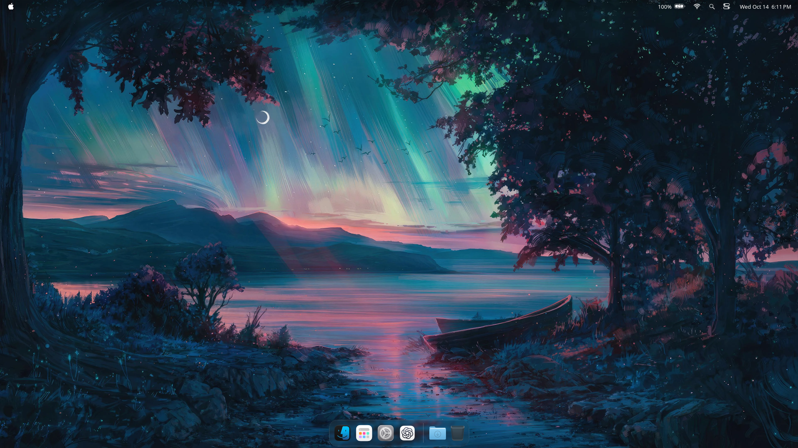

# AquaDesktop

**Tahoe meets Golden Gate on KDE Plasma.**

[](https://kde.org/plasma-desktop/)
[](https://github.com/AshesTom/AquaDesktop/actions/workflows/test.yml)
[](LICENSE)
[](https://github.com/AshesTom/AquaDesktop/issues)

AquaDesktop combines macOS Tahoe's desktop layout with Golden Gate's floating
glass controls. A refractive Dock, translucent menus, rounded popovers and
matching app themes bring the two influences together on KDE Plasma.

AquaDesktop is a fork of
[macos-tahoe-liquid-kde](https://github.com/lestercorderomurillo/macos-tahoe-liquid-kde)
by [Lester Cordero Murillo](https://github.com/lestercorderomurillo). It builds on
upstream's theme pack and installer with its own widgets, glass tuning and
measured desktop details.



*Desktop capture from the local Plasma calibration session.*

> [!WARNING]
> Experimental software. Installation changes desktop settings and installs
> compiled Plasma and KWin components. Use a test system and back up your
> configuration. KDE updates can require rebuilding the components.

## The desktop

- **Liquid Glass.** Better Blur DX renders window and Dock blur, with a
  separate Dock material and edge refraction. Menu-bar popovers use their own
  glass surfaces and blur regions; Control Center modules float independently.
- **Dock.** Shared parabolic magnification across apps, Downloads and Trash,
  launch bounce, running indicators, preserved pinned apps and auto-hide.
  Minimized windows appear as thumbnails after the Downloads stack.
- **Downloads stack.** Open recent downloads in a fan and drag files into apps.
- **Menu bar.** Active app name and supported app menus, Wi-Fi, Sound, Battery,
  keyboard input, Now Playing, Spotlight and the clock panel.
- **Control Center.** Golden Gate-style glass bubbles for connectivity, media,
  Focus, brightness, sound and quick actions. Available controls depend on
  your hardware and installed Plasma backends.
- **Spotlight.** Search apps, files and actions through Plasma's search backends.
- **Matching apps.** Kvantum, GTK and Qt Quick controls, Finder-inspired
  Nautilus, Konsole profiles, window decorations and optional Firefox CSS.
- **Theme Settings.** Light, Dark and scheduled Auto appearance; accent colours;
  Liquid Glass or Frosted; glass tint and intensity; reduced transparency;
  Dock behaviour, minimize animation, hot corners and app icon customization.
- **Session details.** Application switcher, notification banners, session
  splash and logout dialogs, with an optional Plymouth boot splash.

The glass renderer is **Better Blur DX**. The installer removes the older
Glass and Acrylic Glass effects previously used by this project. The historical
`--acrylic-glass` flag selects the current renderer.

## Install

Use a **KDE Plasma 6.6+** desktop with Python 3.10+ and `sudo`. Run the installer
from your normal desktop session. Qt 6, KDE development packages, CMake and a
C++ compiler are needed for compiled components; the installer resolves
supported distribution packages.

```bash
git clone https://github.com/AshesTom/AquaDesktop.git
cd AquaDesktop
./installer
```

The graphical installer uses PyQt6. Choose the components you want before
starting. For the terminal selection wizard:

```bash
sudo ./install
```

`./install` is a Python entry point; there is no shell script to pipe into Bash.
Use flags for a direct terminal installation:

```bash
sudo ./install --dark
sudo ./install --no-plymouth --no-nautilus
sudo ./install --only --fonts --icons
sudo ./install --help
```

The checkout's `features.json` stores component choices. Use `--save` to retain
command-line choices, or `--reset` to restore defaults. Firefox styling, KDE
Rounded Corners and OLED care can be selected separately.

Theme assets and Better Blur DX sources are bundled. Package installation
requires access to your distribution repositories when dependencies are missing.
The optional KDE Rounded Corners component downloads a pinned, checksum-verified
source release. Installation also checks upstream releases; set
`MAC_TAHOE_NO_UPDATE_CHECK=true` to skip that check.

Log out and back in after the first installation so applications load the
Kvantum, Qt Quick and GTK menu environment hooks.

### Platform status

| Platform | Status |
| --- | --- |
| Arch Linux, CachyOS | Tested |
| Manjaro, EndeavourOS, Garuda, Gentoo, Fedora, Nobara, openSUSE Tumbleweed, KDE neon | Testing |
| Artix OpenRC | Testing; outside the container matrix |
| NixOS / Home Manager | Experimental declarative installation via `flake.nix` and `nix/` |

Scheduled appearance changes and OLED care use a systemd user timer or a
per-user crontab on OpenRC. Immutable rpm-ostree systems such as Silverblue
and Kinoite are outside the installer scope.

## Make it yours

Open **Theme Settings** from the app grid, or run:

```bash
mac-tahoe-theme-settings
```

Theme Settings needs GTK 4 and PyGObject; its Icons page also needs PyQt6.
Icons can be imported from `.icns` files or extracted from supported `.dmg`
images, with separate Light and Dark versions and optional tinted or clear
styles.

Reduced transparency is also available in the graphical installer under
**Features → Transparency → Standard / Reduced → Apply now**. Reopen apps
when needed to pick up the change.

The same appearance controls are available in the terminal:

```bash
mac-tahoe-theme-switch light
mac-tahoe-theme-switch dark
mac-tahoe-theme-switch auto
mac-tahoe-theme-switch style tahoe
mac-tahoe-theme-switch style frosted
mac-tahoe-theme-switch transparency reduced
mac-tahoe-theme-switch transparency standard
```

Auto switches at **06:00 and 18:00 local time** when the schedule is installed.
Your chosen wallpapers are preserved across theme changes. Use
`sudo ./install --reset-wallpapers` to let the theme manage them again.

Internal theme names, plugin IDs and `mac-tahoe-*` commands keep their upstream
identifiers so existing installations can upgrade in place.

## Remove or rebuild

```bash
sudo ./uninstall
```

Removal restores Breeze defaults and carries pinned apps back to the default
panel. It does not reconstruct every customization from before installation.
Browser profile backups are retained. For selective removal:

```bash
sudo ./uninstall --only --icons --cursors
```

After a Plasma or KWin update, pull the latest AquaDesktop changes and rebuild
from your desktop session:

```bash
git pull --ff-only
sudo ./install
```

## Contributing

<p>
  <a href="https://github.com/lestercorderomurillo"></a>
  <a href="https://github.com/yanhenrique-dev"></a>
  <a href="https://github.com/tuxkt"></a>
  <a href="https://github.com/caioniehues"></a>
  <a href="https://github.com/404-not-found129"></a>
  <a href="https://github.com/myakupozluk"></a>
  <a href="https://github.com/EMS1998"></a>
  <a href="https://github.com/allfritz"></a>
  <a href="https://github.com/kozeki-uii"></a>
</p>

Report AquaDesktop issues in
[the fork's issue tracker](https://github.com/AshesTom/AquaDesktop/issues).
Include your distribution, Plasma version, the contents of `VERSION`, and a
screenshot for visual problems. See [CONTRIBUTING.md](CONTRIBUTING.md) for the
development workflow.

```bash
./test
```

The suite checks installer behaviour, asset consistency and widget regressions.
Live desktop behaviour also needs testing in a Plasma session.

## License and disclaimer

AquaDesktop is an independent community project, unaffiliated with Apple,
KDE or KDE e.V. Apple and macOS are trademarks of Apple Inc.

The project as a whole is licensed under [GPL-3.0](LICENSE). Individual
components retain their own license notices. Bundled Apple wallpapers,
SF Pro / SF Mono fonts and system sounds are outside that FOSS license.


Thanks to the open-source projects that inspired this one or fed assets into it. Everything here is maintained independently:

- **[EliverLara](https://github.com/EliverLara/TahoeLauncher)**: `TahoeLauncher`, the inspiration for the Launcher plasmoid.
- **[vinceliuice](https://github.com/vinceliuice)**: `MacTahoe-icon-theme` for the icons, cursors, and GTK inspiration; and the [`MacTahoe-gtk-theme` Firefox CSS/SVG](https://github.com/vinceliuice/MacTahoe-gtk-theme/tree/main/other/firefox), maintained here as an MIT-licensed fork and integrated with this project's profile backup and restore system.
- **[xarblu](https://github.com/xarblu/kwin-effects-better-blur-dx)**: Better Blur DX, bundled as the current window and Dock glass renderer (GPL-3.0; pin and local changes in `src/offline/kwin-effects/better-blur-dx/UPSTREAM.md`). Its lineage includes **[taj-ny](https://github.com/taj-ny/kwin-effects-forceblur)** and **[4v3ngR](https://github.com/4v3ngR/kwin-effects-glass)**; 4v3ngR's [glassOS](https://github.com/4v3ngR/glassOS) also inspired earlier glass presets. Original copyright and license notices remain in the sources.
- **[maximilionus](https://github.com/maximilionus/lucidglyph)**: `lucidglyph`, the recommended FreeType / Fontconfig rendering tweaks (not bundled).
- **[Lester Cordero Murillo](https://github.com/lestercorderomurillo/macos-tahoe-liquid-kde)**: `macos-tahoe-liquid-kde`, the project this fork is built on.
- **[cromewar](https://github.com/cromewar/plasma-downloads-stack)**: `plasma-downloads-stack`, bundled as the Dock's Downloads stack and adapted to its proportions and magnification (GPL-3.0, license shipped alongside).
- **[snpynk](https://github.com/snpynk/macesque-taskmanager)**: `macesque-taskmanager`, whose window-thumbnail capture drives the Dock's minimized-windows section (GPL-2.0-or-later).
- **[luisbocanegra](https://github.com/luisbocanegra/plasma-panel-colorizer)**: `plasma-panel-colorizer` v7.3.0, bundled offline and installed by the layout step to tint the panels (GPL-3.0, license shipped alongside).
- **[Matin Lotfaliei / KDE-Rounded-Corners](https://github.com/matinlotfali/KDE-Rounded-Corners)**: the GPL-3.0 KWin rounded-window effect, fetched from the pinned v0.10.0 release and built online against the host KWin SDK (license installed alongside).
- **[ful1e5](https://github.com/ful1e5)**: `apple_cursor`, inspiration for an alternate macOS-style cursor.
- **[sahibjotsaggu](https://github.com/sahibjotsaggu)**: `San-Francisco-Pro-Fonts`, where the SF Pro / SF Mono bundle comes from.
- **[Lucide](https://github.com/lucide-icons/lucide)**: copy icons bundled in the global menu (ISC, © Lucide Contributors).
- **[512pixels.net](https://512pixels.net/projects/default-mac-wallpapers-in-5k/)**: high-resolution macOS wallpaper archive.

Please support their efforts too: star their repos, report bugs upstream, and contribute back when you can.

If a credit is missing, please [open an issue](https://github.com/AshesTom/AquaDesktop/issues/new).
