# Installer testing

Native installer screens for Tahoe 0.61.0, captured in a disposable KDE Plasma VM.
Dark appearance was selected for this installation test.
These images document the current implementation; release qualification is still in progress.

For test commands and the capture workflow, see [CONTRIBUTING.md](CONTRIBUTING.md).

## Installation steps

Scroll horizontally through the installation steps.

<table>
<tr>
  <td align="center">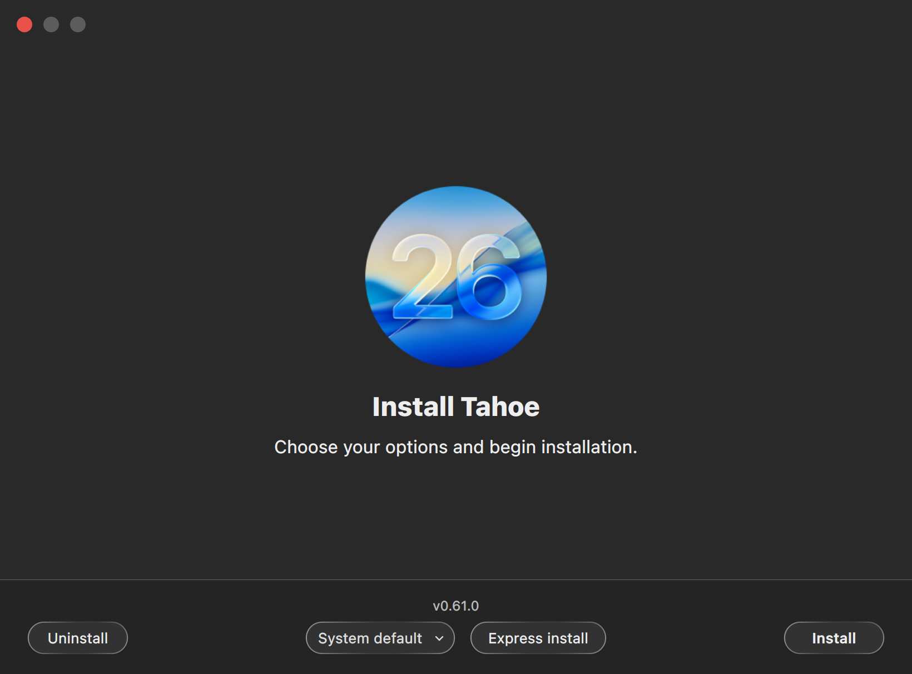 Welcome</td>
  <td align="center">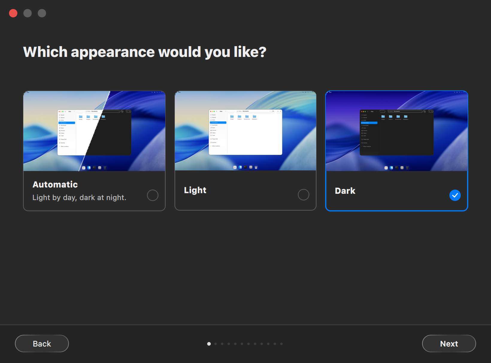 Appearance</td>
  <td align="center">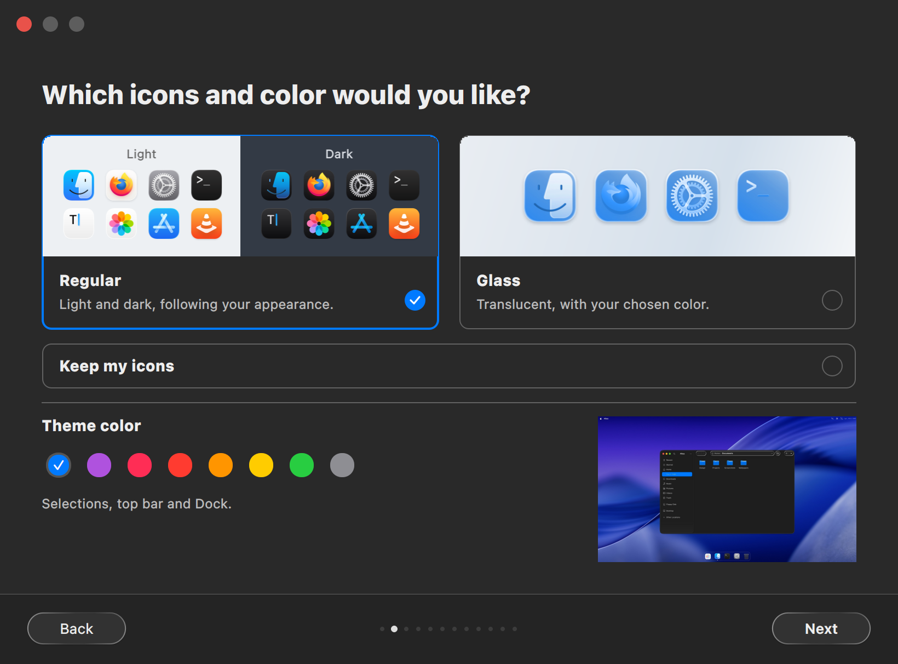 Icons and color</td>
  <td align="center">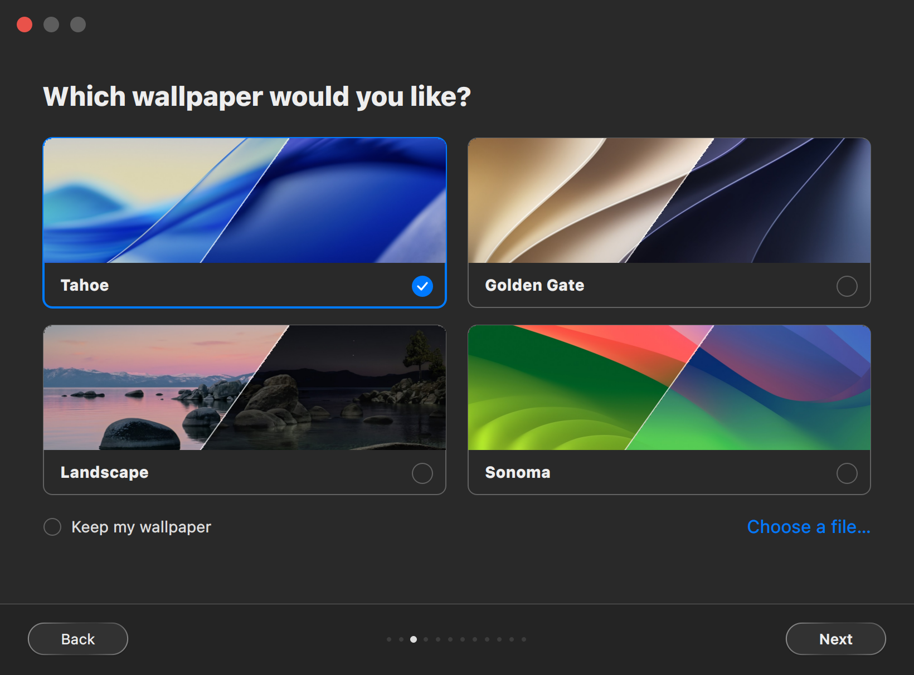 Wallpaper</td>
  <td align="center">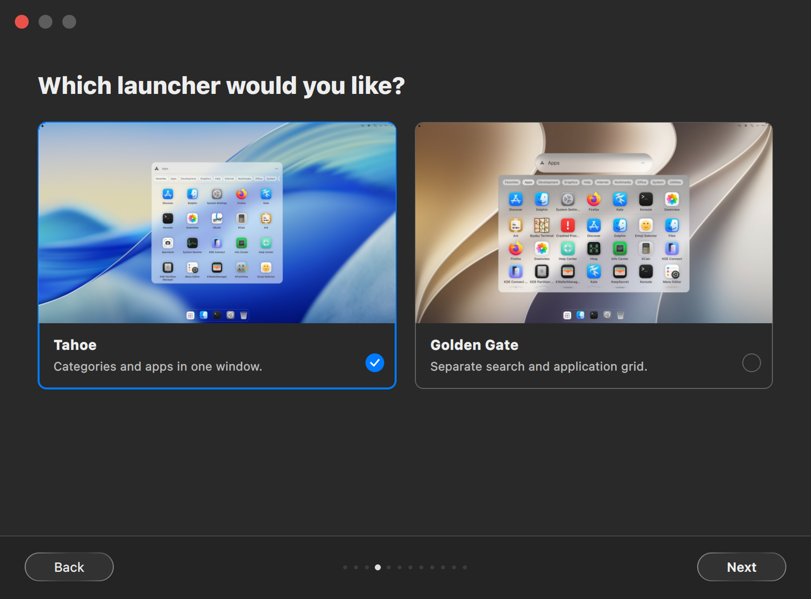 Launcher</td>
  <td align="center">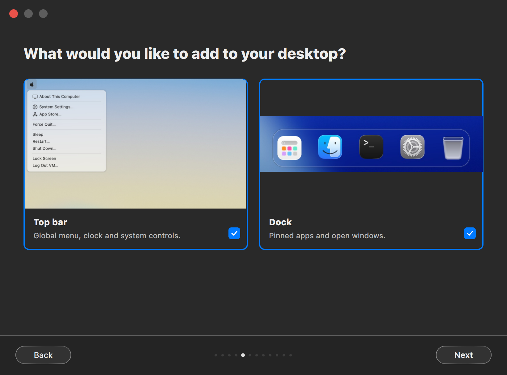 Top bar and Dock</td>
  <td align="center">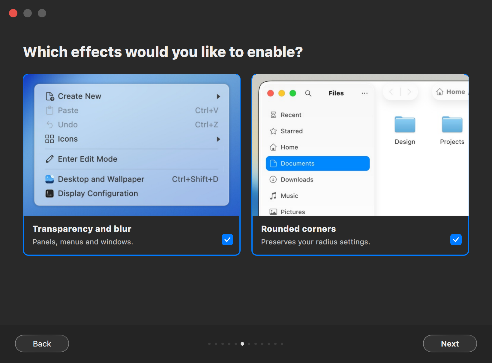 Effects</td>
  <td align="center">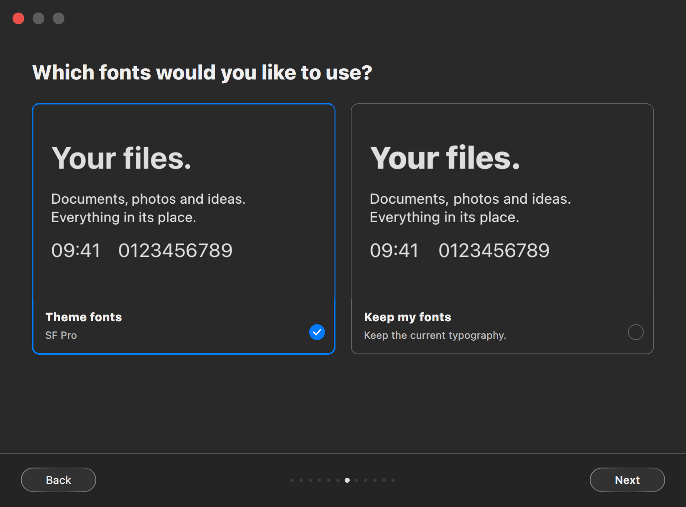 Fonts</td>
  <td align="center"> Firefox</td>
  <td align="center">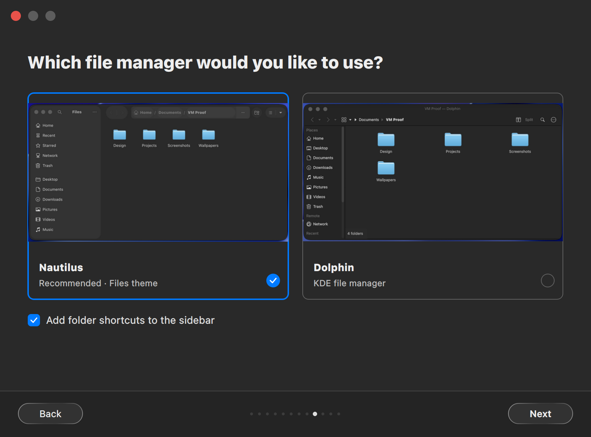 File manager</td>
  <td align="center">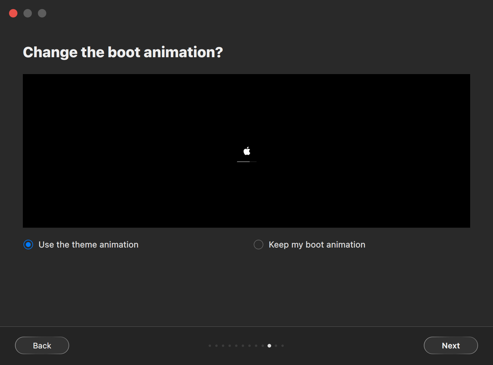 Boot animation</td>
  <td align="center">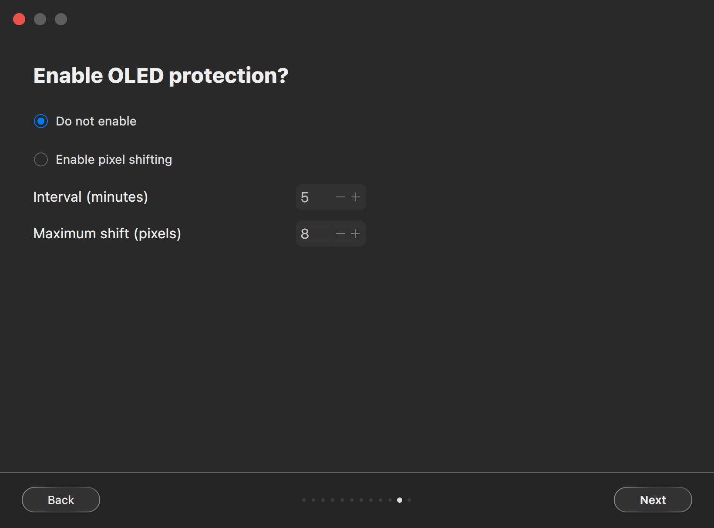 OLED protection</td>
  <td align="center">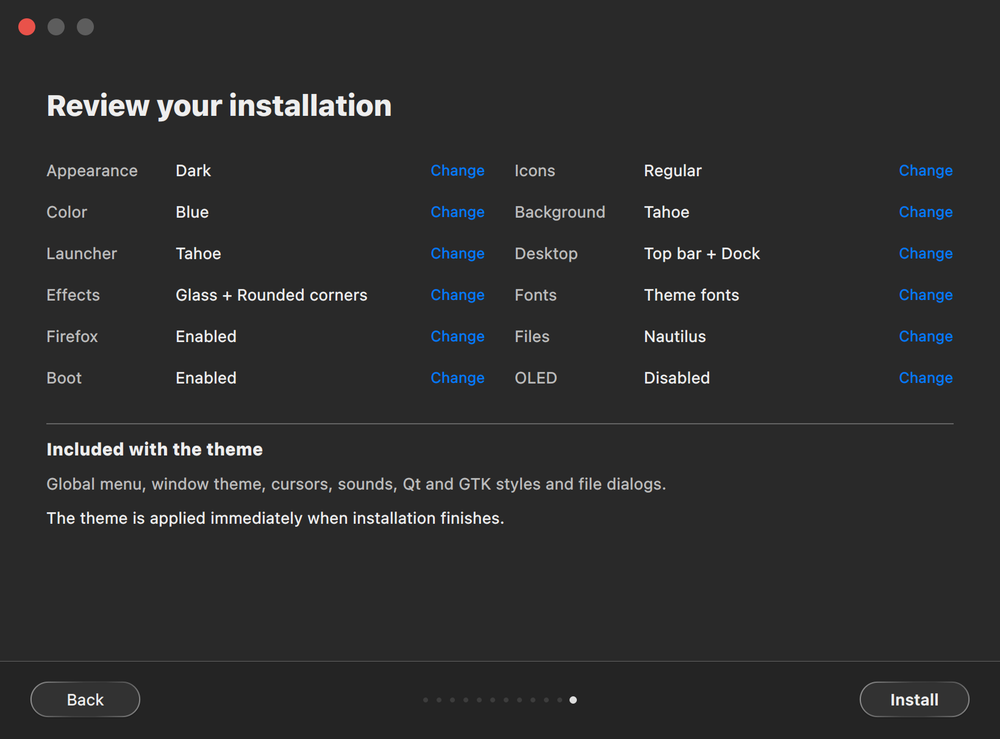 Summary</td>
</tr>
</table>
